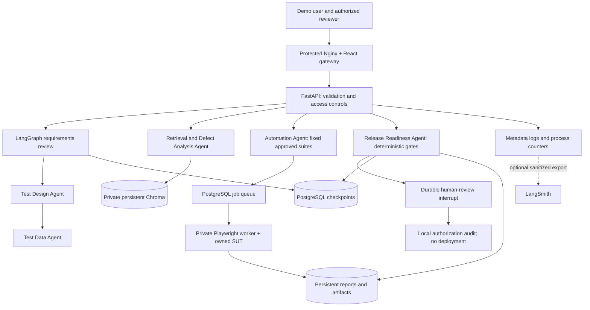

# Implemented architecture and decisions

There are separate graphs for requirements/design/data, routed intelligence tasks, and release readiness. The platform does not claim a single autonomous six-agent graph that makes a release decision. Registered execution and defect analysis feed evidence services; an authorized human attests confirmed defects and regression risks.

1. PostgreSQL checkpoints preserve approval interrupts across API restarts. In-memory checkpoints remain the simple native/testing default. The production DB configuration never silently falls back to memory after an error.
2. A relational queue avoids introducing another broker for this bounded demonstration. Exclusive claims and leases limit duplicate execution. Uncertain jobs fail rather than retry automatically. File audit transitions remain single-process; multi-replica deployment is future work.
3. Fixed suite and SUT registries keep generated test descriptions out of executable code paths. Production workers are separate from the API; browser-based self-healing stays local until it has a separate isolated job type.
4. Nginx supplies same-origin frontend/API routing with a demo login, while release review requires another capability. The localhost deployment has one trusted operator; OIDC/RBAC and public TLS are future work.
5. A manifest defines requirement execution coverage separately from semantic coverage. Missing reviews remain unknown. Model summaries never replace deterministic gates.
6. Telemetry stores metadata only. Raw LangGraph tracing is forbidden in controlled mode to avoid exporting state contents. Optional sanitized export requires explicit configuration.
7. Dependency findings block CI and staging. Container isolation is a mitigation, not a substitute for resolving the Chroma advisories.

References: [PostgreSQL checkpointer](https://github.com/langchain-ai/langgraph/blob/main/libs/checkpoint-postgres/README.md), [Compose health dependencies](https://docs.docker.com/compose/how-tos/startup-order/), [GitHub deployment environments](https://docs.github.com/en/actions/concepts/workflows-and-actions/deployment-environments).
